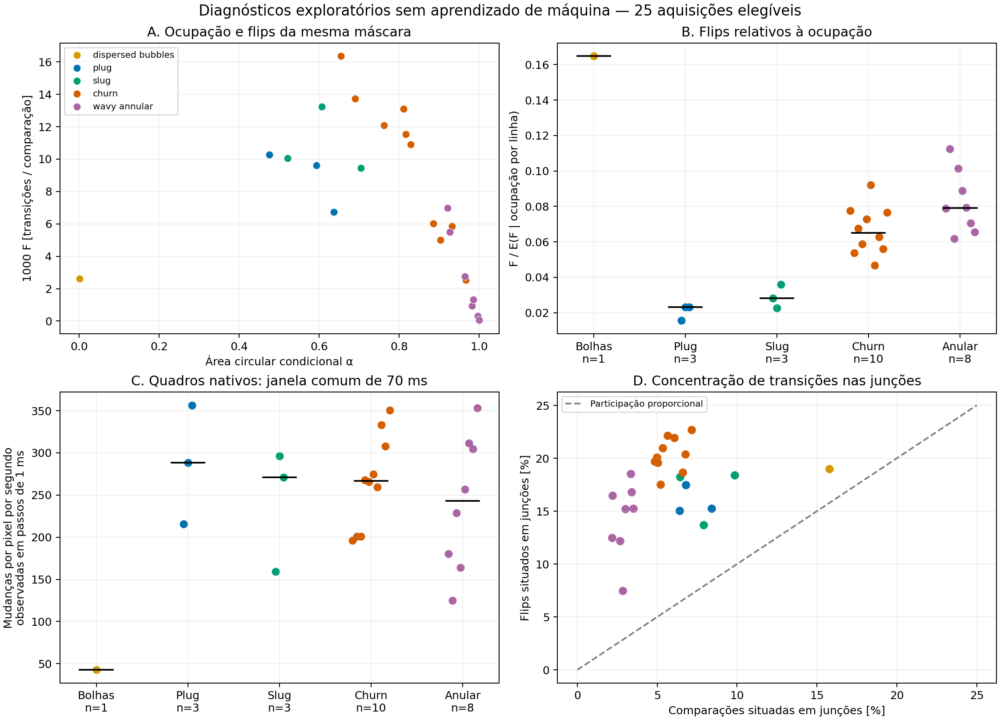

# Auditoria independente de v14.1 e alternativas sem aprendizado de máquina

Auditoria realizada em 27 de outubro de 2026 sobre o estado ativo de `src2/v14.1_new_voidfraction`, confrontado com o TCC atual. Os resultados numéricos novos estão em [resultados/voidfraction](../resultados/voidfraction/); os arquivos da v14.1, do TCC e dos dados originais foram apenas lidos. A avaliação inicial foi formada sem consultar os relatórios dos outros auditores da v17.

**O núcleo numérico da v14.1 foi reproduzido.** Não foi encontrado erro de contagem de pixels, de denominador dos flips, da soma de áreas circulares ou de montagem dos panoramas corrigidos. O principal limite continua sendo a interpretação física da máscara. A auditoria acrescentou uma contraprova quantitativa: a diferença de flips entre churn e anular muda de direção quando se condiciona o descritor à ocupação binária de cada linha. Portanto, separabilidade no plano α–F não demonstra atividade de interfaces independente da ocupação. A separação bruta observada continua existindo.

## O que foi efetivamente verificado

O [script reprodutível](../scripts/audit_voidfraction.py) não executa classificadores e só grava em `src2/v17`. A reconstrução por JPEG, o recálculo dos deslocamentos e a aritmética de área/flips têm implementação própria. A reprodução das máscaras chama a função original de segmentação; ela verifica consistência entre código e artefatos, **não constitui uma segunda segmentação física independente**.

| Verificação | Resultado |
|---|---:|
| Manifesto de fontes conferido | 13.105 arquivos |
| Fontes com hash diferente | 1, `src2/pipeline_v11.py` |
| JPEGs nativos reconstruídos | 13.026, em 26 aquisições |
| Deslocamentos entre quadros recalculados | 13.000; todos iguais ao CSV salvo |
| Conferência adicional por Pearson direto | 3 intervalos por aquisição, todos iguais |
| Panoramas corrigidos reconstruídos pixel a pixel | 26/26 idênticos |
| Referência líquida recalculada | erro máximo 0 |
| Máscaras recalculadas contra máscaras salvas | 26/26 idênticas |
| Reversão axial da entrada e da máscara | 26/26 invariantes |
| Área circular por contagem independente de intervalos | erro máximo 1,11 × 10⁻¹⁶ |
| Fração projetada e flips | erro máximo ≤1,11 × 10⁻¹⁶ |
| Limiar Otsu nativo recalculado independentemente | 26/26 iguais |
| Contagens de flips nativos em cinco sondas | 26/26 iguais |

Evidências: [summary.json](../resultados/voidfraction/summary.json), [reconstrução bruta](../resultados/voidfraction/raw_reconstruction_checks.csv), [aritmética e junções](../resultados/voidfraction/arithmetic_and_seam_checks.csv) e [deriva de hashes](../resultados/voidfraction/source_hash_drift.json). O script inclui versões de Python/NumPy/pandas; os cálculos são determinísticos, sem treinamento. As novas comparações de Mann–Whitney usam `method='auto'`: método exato quando o menor grupo tem até oito aquisições e não há empates; caso contrário, aproximação com correção de empates/continuidade.

## VF01 Ocupação e flip-rate compartilham uma restrição matemática

**Prioridade alta para interpretação; limitação estrutural, não erro da fórmula.** A v14.1 já reconhece que ambos os eixos derivam da mesma máscara (`scripts/summary_text.py:87–93`). A consequência quantitativa era menos explícita: a região de α muito alto necessariamente tem pouco espaço para flips.

Se `q` é a fração projetada de pixels marcados, `W` a largura e `H=53`, a área circular implementada é

`α = média_j Σ_k (d_kj/H)²`.

Como `d_kj ≤ H`, tem-se `α ≤ q`. Em cada linha binária, o número de mudanças entre vizinhos não excede duas vezes a contagem do estado menos frequente. Logo,

`F ≤ 2 W/(W−1) min(q,1−q) ≤ 2 W/(W−1)(1−α)`.

Essa é uma restrição combinatória, mesmo sem qualquer informação sobre escoamento. Não significa que todos os pontos atinjam o limite, nem que a ocupação explique integralmente suas diferenças.

Foi calculado um descritor auxiliar preservando a ocupação `p_r` de cada linha:

`E_shuffle(F) = média_r [2 p_r(1−p_r) W/(W−1)]`,

`R = F/E_shuffle(F)`.

O denominador é a esperança exata de flips após permutar as colunas de uma sequência finita mantendo as contagens por linha. Ele destrói autocorrelação e organização espacial. **Não é um nulo hidrodinâmico validado**, nem a divisão recupera um “verdadeiro F de fase”. Para linhas/cenas quase constantes, o denominador pequeno exige cautela. Aqui o valor médio por aquisição permaneceu definido nas 26 imagens.

| Descritor, 25 aquisições elegíveis | Mediana churn, n=10 | Mediana anular, n=8 | P(churn > anular), empírica |
|---|---:|---:|---:|
| F original da máscara | 0,0112225 | 0,00112673 | 0,9125 |
| F excluindo comparações nas junções | 0,00951323 | 0,00102189 | 0,9125 |
| F / esperança com ocupação preservada | 0,0651586 | 0,0791018 | 0,2250 |

Os valores de Mann–Whitney correspondentes são 0,00206, 0,00206 e 0,05453, respectivamente; são **exploratórios, sem correção por multiplicidade**. A coluna de probabilidade usa todos os pares de aquisições dos dois grupos, contando empate como meio; é uma ordenação descritiva, não acurácia de classificador ou validação preditiva. Os pares compartilham aquisições; a unidade do teste de Mann–Whitney é a aquisição, não cada par.

**Contraprova e conclusão delimitada:** a direção oposta de R não refuta a separação de F, pois são estimandos distintos. Ela mostra que “anular tem menos flips” e “anular tem maior persistência relativa à ocupação” não são afirmações equivalentes. Recomenda-se apresentar F e ocupação separadamente e usar R como controle de mecanismo, sem substituir a métrica principal por uma alternativa escolhida por seu resultado. Evidência: [diagnósticos entre grupos](../resultados/voidfraction/non_ml_group_diagnostics.csv).

## VF02 A correção da sobrescrita não elimina a concentração de transições nas junções

**Prioridade média; dependência de processamento confirmada, com contraprova favorável à robustez.** `scripts/reconstruct_inputs.py:55–69` distingue a concatenação corrigida da montagem antiga que sobrescrevia colunas. A correção foi reproduzida exatamente. Entretanto, uma junção ainda coloca lado a lado amostras de quadros diferentes.

Nas 26 aquisições, a participação mediana das junções foi **5,284% das comparações adjacentes**, mas **17,887% dos flips da máscara**. A participação nos flips variou de 7,504% a 22,703%. A contagem identifica apenas a comparação cruzando a junção; não estima todos os efeitos indiretos do fechamento morfológico ou da seleção de sombras em suas proximidades.

Ao remover as comparações cruzando junções e ajustar o denominador, a ordenação churn–anular permaneceu igual: probabilidade empírica 0,9125, nas 25 aquisições. Portanto, **não há suporte para atribuir a separação inteira às junções**. O nível absoluto de F depende delas, e o fato de ocorrerem a cada tira faz com que a extensão reconstruída e o movimento aparente entrem no descritor. Não se demonstrou que cada transição localizada numa junção seja artificial: uma interface real também pode cruzá-la.

Persistiram 61 deslocamentos não positivos entre os 13.000 intervalos: 60 em `m03q40_001` e um deslocamento zero em `m04q01_001`, `ImgA000347.jpg`. O primeiro registro fica fora da estatística v14.1 pelo critério de saturação; o segundo permanece. `reconstruct_inputs.py:89–94` preserva a substituição por uma coluna. Reproduzir a política não demonstra advecção física correta.

Recomendação: manter um indicador de qualidade por tira, reportar F com e sem comparações de junção e considerar uma análise paralela dos quadros nativos. Nenhum panorama foi substituído nesta auditoria.

## VF03 O mapa de separabilidade depende de parâmetros ópticos e da informação disponível

**Prioridade alta para generalização; limitação já reconhecida, ampliada por controles novos.** A referência usa três panoramas plug escolhidos visualmente (`panorama_void_alternatives.py:28,42–53`); o detector usa limiar de razão 0,70, mínimos radiais em janelas fixas, persistência mínima de 20 colunas, fechamento 3×3 e componentes de pelo menos 4 pixels (`:68–107`). Parâmetros comuns a todos os grupos evitam ajuste individual, mas não tornam o desenvolvimento cego aos rótulos ou independente desta amostra.

Os limiares 0,60–0,80 produzem amplitude máxima de **0,11053 em α**, em `m07q40_001`. A maior amplitude entre variantes da referência é **0,007311**, em `m07q80_001`. No caso `m04q01_001`, a diferença entre as cinco médias de blocos espaciais chega a **0,36667**, muito maior que sua amplitude entre limiares, 0,05013. Trata-se de heterogeneidade do registro; cinco blocos contíguos não são cinco repetições experimentais independentes.

Os próprios resultados salvos mostram que as envoltórias plug–slug deixam de se interceptar apenas no limiar 0,70, dentre os cinco avaliados; nos outros quatro há interseção. Churn–anular têm interseção em todos os cinco. Assim, um gráfico particular não estabelece uma fronteira estável ou separabilidade universal. A ausência de interseção de envoltórias de três aquisições por classe é especialmente limitada.

O aumento do limiar retirou alguns pixels previamente marcados em **66 de 104** comparações consecutivas, por mudança da conectividade e rejeição de componentes que passam a tocar a borda. **Nenhuma dessas 104 comparações diminuiu a média α.** Isso refuta uma alegação mais forte de erro escalar ou de não monotonicidade observada em α: o efeito comprovado é local nas máscaras. Não foi encontrado no relatório original compromisso de monotonicidade pixel a pixel que caracterizasse descumprimento.

Como diagnósticos adicionais, trocar a sonda fixa y=40 pela linha y=44 preservou a ordenação churn–anular, com probabilidade empírica 0,8625. A v14.1 já documenta que y=40 não é o centro físico (`phase_mask_flip_analysis.py:81–87`). A reflexão simultânea da imagem e referência **apenas dentro do lúmen** alterou α em até 0,03679; essa intervenção interage com janelas fixas e bordas, não representa uma simetria física exigível pela óptica, e não fundamenta um achado de erro. Está registrada para transparência, sem integrar as conclusões principais.

Recomendação: usar uma matriz de sensibilidades com o mesmo subconjunto de aquisições, manter todas as variantes e suas mudanças de ordenação, examinar estabilidade por blocos e recolher aquisições independentes. Não selecionar a variante por maior separação nesta amostra. Evidências: [robustez](../resultados/voidfraction/robustness_probes.csv), [conectividade entre limiares](../resultados/voidfraction/threshold_monotonicity.csv) e `v14.1/results/summary/threshold_hull_intersections.csv`.

## VF04 A área circular está correta condicionalmente, mas o filme líquido permanece sem resolução validada

**Prioridade alta se o número for interpretado como fração volumétrica medida; limitação física conhecida, não bug.** `panorama_void_alternatives.py:111–121` implementa `Σ(d/D)²`, com média das áreas, não quadrado da largura média. A reconstrução independente confirmou os valores e o teto α=1 quando toda a seção fica marcada.

A fórmula exige que cada intervalo visível represente o diâmetro de uma seção circular de gás e que sobreposições na profundidade não alterem a projeção. Uma imagem lateral de brilho/sombra não identifica de forma única essas hipóteses. O algoritmo preenche o espaço entre sombras e pode apagar fragmentos líquidos internos; componentes escuros sem contorno fechado também podem ser mantidos. Essas limitações estão explícitas nos comentários `:85–107` e em `phase_mask_flip_analysis.py:138–141`.

Em `m03q20_001`, α=0,9997686 e **99,406% das colunas têm todas as 53 linhas marcadas**. Em `m04q80_001`, essa proporção é 98,299%. Isso indica saturação geométrica da máscara e falta de uma espessura de filme resolvida nesse indicador. Não demonstra que o filme tenha desaparecido fisicamente ou que sua fração real seja aquela calculada. A imagem visual foi conferida em `figures/void_fraction/panorama_phase_masks.png`; essa inspeção não fornece referência independente de fase.

Recomendação: denominar o produto como área circular condicional ou índice morfológico, manter também fração projetada, contato com borda e proporção de colunas completamente marcadas. Para medir vazio físico, seriam necessários referência de fase/óptica e modelo de projeção adequados; esses dados não foram presumidos disponíveis. No objetivo atual de semelhança/separabilidade, os descritores podem permanecer úteis sem alegar calibração volumétrica.

## VF05 O manifesto upstream está desatualizado em um arquivo, sem falha numérica detectada

**Prioridade baixa; inconsistência de procedência confirmada.** `results/validation/source_input_hashes.json` guarda o SHA-256 `663b91…76c6` para `pipeline_v11.py`; o arquivo atual tem `14046a…1417`. Todos os outros 13.104 itens conferem. O código atual não é byte a byte o código cujo hash foi registrado.

**Contraprova:** todos os deslocamentos e panoramas corrigidos foram reproduzidos, inclusive uma verificação de Pearson direto em 78 intervalos. Portanto, a divergência de hash não demonstra resultado numérico incorreto ou mudança nos dados. O estado `passed: true` de um relatório histórico deve ser associado à sua data e ao snapshot, não entendido como verificação automática do ambiente atual. `final_verification.py:60–92` confere panoramas e fonte da segmentação; isso não equivale a reconferir todos os arquivos upstream.

Recomendação: em futura execução autorizada, manter o manifesto histórico e acrescentar a nova execução com hash, data e ambiente. Esta auditoria apenas registrou a divergência em v17.

## Comparação precisa com o texto atual do TCC

| Item | v14.1 ativa | TCC atual | Juízo |
|---|---|---|---|
| Origem dos panoramas | Tiras concatenadas, sem sobrescrita de emenda | Panoramas originais, com mistura/sobrescrita preservada | Entradas diferentes, explicitadas; resultados não intercambiáveis |
| Faixa usada | `18:71`, linhas 18–70, 53 células | Linhas 18–71 inclusivas, média dividida por 54 | Diferença de ROI; não é erro interno em nenhuma fórmula |
| Seleção | 26 aquisições; 25 em estatísticas após S>0,20 | 26 aquisições, mantendo m03q40 com análise de qualidade | Comparações cruzadas precisam de subconjunto comum |
| Grandeza principal | Máscara, α condicional e densidade espacial F | Intensidade média, CWT/WPS/WCO e Pearson | O TCC não afirma converter intensidade em vazio |
| Movimento e escala | Larguras de tiras com clamp ≥1 | Mesmo legado; eixo explicitamente não calibrado | Limite comum; reconstrução exata não prova advecção correta |
| Bolhas dispersas | Uma aquisição | Uma aquisição, sem repetibilidade intrapadrão | Restrição comum corretamente indicada |

Evidências do texto: `TCC/metodologia.tex:59–69,75–105`; a fórmula 54 linhas está em `:84–97`. `TCC/discussao.tex:102–113` já distingue execução do algoritmo de validade do movimento e registra 60 substituições em m03q40. `TCC/resultados.tex:103` preserva intensidade relativa sem transformá-la em vazio. Assim, **os limites físicos da v14.1 não constituem, por si, contradição do resultado espectral apresentado no TCC**. O risco é misturar números de conjuntos/ROIs diferentes sem identificá-los.

## Experimento preliminar com tempo nativo comum

O código original calcula mudanças ópticas por segundo a partir de taxas de câmera distintas e registros de aproximadamente 71,4–125 ms (`raw_flip_analysis.py:113–161`). Multiplicar flips/comparação por fps é aritmeticamente correto, mas muda a escala temporal observada entre ensaios: a contagem de mudanças entre extremos depende do intervalo entre amostras.

Foi calculado um controle comum, **sem panorama, sem segmentação de fase e sem modelo aprendido**: mesmas cinco colunas de câmera, linhas 20–59, limiar Otsu nativo de cada aquisição, estados observados a cada 1 ms durante 70 ms. As taxas 4.000/5.000/7.000 fps permitem selecionar os instantes exatamente, sem interpolação. Não foi aplicado filtro antes da seleção porque a pergunta é a mudança entre estados em instantes separados por 1 ms. Consequentemente, o produto não conta todas as passagens ocorridas dentro desse milissegundo nem resolve frequências acima de Nyquist.

| Medida, 25 aquisições elegíveis | Churn, mediana | Anular, mediana | P(churn > anular), empírica |
|---|---:|---:|---:|
| Taxa óptica original, toda a duração nativa | 1226,785 | 939,155 | 0,6375 |
| Taxa de mudanças observadas em 1 ms, janela comum de 70 ms | 266,929 | 242,929 | 0,6125 |

Os p-valores exploratórios não corrigidos são 0,35993 e 0,45976, pelo cálculo exato nesta v17. A v14.1 usa explicitamente a aproximação assintótica para a primeira medida e salva p=0,35085; essa pequena diferença de método não é erro da análise original. **A separação temporal descritiva é menor que a separação espacial da máscara**; isso não demonstra igualdade entre grupos nem invalida diferenças espaciais, porque domínio e estimando mudam. Incluir a aquisição saturada produz probabilidades 0,6778 e 0,6556, respectivamente: a conclusão de sobreposição permanece. A seleção por saturação do panorama é herdada para comparação, não um critério validado de qualidade dos dados nativos.

Evidência: [controle temporal](../resultados/voidfraction/native_common_time_diagnostics.csv). Os limiares por aquisição e as exposições/óptica diferentes permanecem condicionantes; a janela comum não estabelece estacionariedade de longo prazo.



## Caminhos recomendados sem aprendizado de máquina

1. **Caracterizar ocupação e organização separadamente.** Usar fração projetada, distribuição de comprimentos de intervalos, F e sua razão ao nulo de ocupação; manter intervalos censurados pelas bordas identificados. Comparar distribuições por aquisição com distância de Wasserstein ou distância de energia, sem transformar milhares de pixels em repetições.
2. **Criar perfis de semelhança com e sem montagem.** Contrastar descritores de panoramas com estatísticas dos quadros nativos em janelas/deltas temporais comuns. A análise temporal acima é um primeiro controle; outros deltas devem ser planejados e todos reportados, sem escolher o que maximiza separação.
3. **Estudar estabilidade dentro de cada registro.** Blocos contíguos revelam mudanças do padrão e da qualidade, mas intervalos de incerteza por bloco requerem tamanho relacionado à dependência. Não chamar cinco blocos de cinco ensaios.
4. **Controlar qualidade e condições operacionais no nível da aquisição.** Usar exposição, saturação, taxa da câmera e qualidade dos deslocamentos como diagnósticos; separar comparações em condições com suporte comum. Com apenas 26 aquisições e grupos de n=1 ou n=3, modelos de ajuste muito ricos seriam instáveis.
5. **Validar a semântica da máscara antes de chamá-la de fase.** Anotações independentes, avaliadas por região e sem ajustar ao rótulo desejado, poderiam quantificar falso preenchimento de líquido e perda de bolhas. Essa validação pode ser manual e geométrica, sem aprendizado de máquina.

Para reproduzir os resultados desta auditoria a partir da raiz do repositório:

```sh
PYTHONDONTWRITEBYTECODE=1 python3 -B src2/v17/scripts/audit_voidfraction.py
PYTHONDONTWRITEBYTECODE=1 python3 -B src2/v17/scripts/plot_voidfraction_audit.py
```

Não executar `v14.1/scripts/run_all.py` para reproduzir a v17: esse comando grava na análise original e inclui classificadores. Os scripts acima preservam o escopo de somente escrita em v17.
