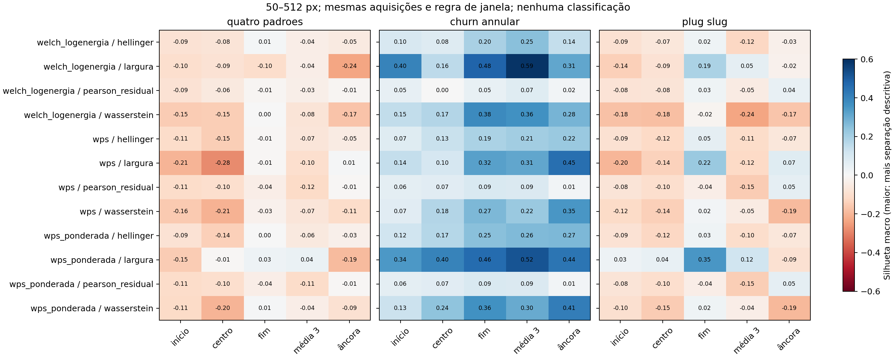

# Confronto com o TCC e exploração de separabilidade

Data: 27/10/2026. O texto analisado foi o estado atual de `TCC/*.tex`, inclusive suas alterações anteriores a esta auditoria. Nenhum arquivo do TCC foi editado. A exploração abaixo usa apenas estatística descritiva, processamento de sinais e distâncias; não ajusta classificadores.

Nota de procedência: a conferência final detectou alterações concorrentes no TCC, externas às escritas desta tarefa. As tabelas foram conferidas novamente no estado final e continuaram corretas. As referências de linha abaixo seguem a leitura inicial; a [reconciliação](reconciliacao_texto_atual.md) identifica a versão final e as referências atualizadas. A auditoria não reivindica igualdade do TCC entre o início e o fim.

## Correspondência efetiva com o texto

**As tabelas principais e as figuras da execução v16 conferem com o TCC.** Foram comparadas automaticamente as 26 linhas do índice de ensaios, 104 células numéricas das outras sete tabelas de resultados/discussão e os hashes de 12 figuras. Todas passaram. Nas células com decimais, a tolerância correspondeu ao arredondamento a quatro casas; os contrastes foram calculados antes de arredondar. Essa conferência verifica transcrição e procedência; a validade física depende dos controles discutidos adiante.

Evidências: [verificações](../resultados/comparacao_tcc/verificacoes.json), [figuras e hashes](../resultados/comparacao_tcc/figuras_sha256.json), [script](../scripts/audit_comparacao_tcc.py). As verificações independentes das operações e dos pixels estão nos três relatórios especializados.

| Tema | Texto atual | Parecer da auditoria |
| --- | --- | --- |
| Execução de referência | `metodologia.tex:3–9`: v16_spatial2_18_71, exploratória e descritiva | Correto; estatistica8 e v14.1 não são a execução apresentada |
| Amostra | `metodologia.tex:44–63`: 26 ensaios, cinco classes, 325 pares | Confere; uma única bolha dispersa não permite repetibilidade interna |
| Extração | `metodologia.tex:84–105`: 54 linhas, índices 18 a 71 inclusivos | Confere com `[18:72]`; difere do lúmen de 53 linhas de v14.1 |
| Preparação | `metodologia.tex:111–140`: inversão, reta, centralização e desvio populacional | Confere; o texto não confunde isso com estacionariedade ou correção óptica |
| Correlações | `metodologia.tex:146–172`: divisor N e lags bilaterais | Confere; adaptação em relação a N−|lag| declarada |
| WPS/WCO | `fundamentacao.tex:629–669`: módulo da CWT da autocorrelação e razão do módulo quadrático cruzado | Confere; não é a WCO clássica sem suavização nem a CWT direta de intensidade |
| Pearson | `metodologia.tex:298–340`: resíduos de log WPS no atraso zero, perfis individuais completos | Confere; não compara diretamente intensidade, fase, amplitude ou potência média |
| Escore WCO | `metodologia.tex:261–292`: máximo em lag por escala e pesos de potência | Confere; o texto reconhece que os máximos não exigem um único alinhamento |
| Inferência | `resultados.tex:368–373` e `discussao.tex:252–287` | Confere: pares compartilhados, amostra desbalanceada e confusão operacional são explicitados |
| Semelhança versus separabilidade | `conclusao.tex:9–25` | Os números sustentam contraste médio positivo de Pearson, mas não identificação global de classes |

Não se identificou contradição numérica nas tabelas conferidas. Tampouco seria correto acusar o texto de converter brilho em fração de vazio, de anunciar 95% de acurácia ou de tratar 325 pares como réplicas: ele não faz essas afirmações.

## As três pastas não estudam exatamente a mesma população nem a mesma medida

| Elemento | v16 e TCC | estatistica8 | v14.1 |
| --- | --- | --- | --- |
| Seleção inicial | 26 aquisições, cinco classes | 25, quatro classes | Mesmas 26 selecionadas da v16 |
| Exclusão relevante nas estatísticas | Mantém m03q40 com ressalva | Retira bolha dispersa m07q01 | Corte óptico retira m03q40; mantém m07q01 |
| Unidade espacial | Panorama completo para Pearson; prefixo comum por par para WCO | Janela 2048 centrada na âncora | Panorama e máscara óptica; controles também nos quadros nativos |
| Faixa espectral | 50–3000 px | 50–1024 px | Não é o mesmo estimando espectral |
| Faixa radial | 54 linhas, `[18:72]` | 54 linhas, `[18:72]` | Lúmen `[18:71]`, 53 linhas |
| Grandeza principal | Forma residual e coerência de intensidade | Distribuições/descritores espectrais, distâncias e análises herdadas de vizinhos | Silhueta óptica, área circular condicional, ocupação e transições |

**Os dois subconjuntos de 25 aquisições não são o mesmo subconjunto.** A interseção de estatistica8 com os registros elegíveis de v14.1 contém 24 aquisições. Diferenças de ROI, seleção e montagem impedem atribuir diferenças de resultado apenas à fórmula do descritor. Os rótulos concordam após harmonizar o singular/plural de bolha dispersa. [Cobertura por aquisição](../resultados/comparacao_tcc/coortes.csv).

## C17-01 — Alta relevância — O singleton influencia muito o contraste balanceado

O TCC já informa que bolhas dispersas têm uma única aquisição (`resultados.tex:264–269`). A ponderação macro dá a cada combinação de classes o mesmo peso: esse único registro participa de **quatro das dez combinações interclasse**, somando 40% do peso da média interclasse, sem ter grupo intraclasse correspondente. Isso é matematicamente fiel à regra declarada, mas altera a interpretação de “contraste global”.

Recalcular as mesmas matrizes sem reestimar descritores produz:

| Conjunto | Δ Pearson por par | Δ Pearson balanceado | Δ WCO por par | Δ WCO balanceado |
| --- | ---: | ---: | ---: | ---: |
| 26, referência do TCC | 0,065889 | 0,145300 | −0,075888 | −0,064322 |
| 25, sem a única bolha dispersa | 0,028735 | 0,016502 | −0,064628 | −0,023091 |
| 25, sem m03q40 | 0,054941 | 0,140256 | −0,073040 | −0,065992 |
| 24, sem ambos | 0,015936 | 0,007977 | −0,061168 | −0,024219 |

A queda de 0,145300 para 0,016502 equivale a aproximadamente 88,6% do contraste macro original. Isso **não é uma estimativa causal da contribuição de bolhas dispersas**: a retirada muda a população-alvo e os pesos, de dez para seis combinações interclasse. O controle mostra que o valor macro elevado não caracteriza igualmente a separação das quatro classes com réplicas.

Contraprova: os contrastes de Pearson permanecem positivos nas quatro configurações, e os de WCO permanecem negativos. Portanto, o controle não refuta a direção do resultado descritivo do TCC. Refuta a interpretação de que a magnitude macro original seria representativa da separabilidade de todas as classes com replicação. Recomenda-se apresentar o conjunto de cinco classes e o contraste das quatro classes com replicação em paralelo, mantendo o singleton como estudo individual.

Evidência: [tabela completa](../resultados/exploracao/efeito_composicao_tcc.csv), [médias por combinação](../resultados/exploracao/efeito_composicao_grupos.csv); cálculo em `scripts/exploracao_espectral.py:130–157`. A análise com e sem m03q40 já consta do TCC; o novo controle é a retirada do singleton e a retirada conjunta.

## Exploração de distribuições espectrais sem aprendizado de máquina

Foram preservadas as 25 aquisições de estatistica8 e seus rótulos. A regra de extração nova não consultou os rótulos: prefixo, centro e sufixo de 2048 pixels. A âncora antiga foi mantida como comparação. A preparação foi a mesma: média radial de 54 linhas, inversão, remoção de tendência linear e padronização populacional. Para a aquisição mais curta desse conjunto, de 5071 pixels, algumas janelas se sobrepõem; nenhuma janela é tratada como réplica independente.

O [protocolo](../PROTOCOLO.txt) fixou duas bandas, 50–512 e 50–1024 pixels, antes dos novos resultados. Foram usadas 200 posições logarítmicas. A faixa 50–512 permite ao menos quatro ciclos de λ máximo numa janela de 2048, mas apenas dois em cada segmento Welch de 1024; continua havendo incerteza espectral. Zero padding para 8192 pontos apenas interpola a FFT.

Foram comparadas três distribuições:

1. **WPS alternativa:** `P(λ) = |W_Rxx(a,0)|`, ponderada pelo passo em log λ. A soma direta da Morlet reproduziu todos os 25 perfis de âncora originais com erro absoluto máximo de 7,11 × 10⁻¹⁵.
2. **WPS reponderada:** `P(λ)/sqrt(λ)`, com a mesma quadratura. É uma sensibilidade à ponderação, não uma correção obrigatória do método antigo. Na aproximação de espectro localmente suave, a CWT da autocorrelação no centro é proporcional a `S(f)/sqrt(a)`, enquanto potência por log comprimento de onda é proporcional a `f S(f)`. Isso motiva a reponderação, mas não demonstra equivalência exata com Welch.
3. **Welch por log λ:** PSD unilateral de intensidade padronizada, Hann, segmento 1024, sobreposição 512, `fs=1`, `detrend=False` após o preparo comum. Com `f=1/λ`, a mudança de variável dá `|df/dlogλ|=f`; assim, a densidade é `f S(f)`. A integral está condicionada à banda escolhida e é normalizada para soma 1. “Potência/energia” aqui se refere ao sinal óptico processado, sem calibração em fração de vazio ou energia hidrodinâmica.

As distâncias foram Hellinger, Wasserstein em log λ, distância cordal do Pearson residual `sqrt(2(1−r))` e diferença absoluta da largura interquartil. A silhueta é calculada com os grupos experimentais dados e depois promediada com peso igual por classe; não houve estimação de classes, escolha de limiar ou previsão de rótulos.

Além das janelas individuais, calculou-se **a média das três distribuições normalizadas por aquisição**. A largura dessa mistura não é a média das três larguras: ela reúne dispersão dentro das janelas e diferenças entre seus espectros. A mistura confere peso igual a cada localização; não equivale a estimar a PSD de todo o panorama ou a juntar potências brutas. Essa é uma nova definição explícita de descritor.

Todos os 360 resultados descritivos foram preservados, inclusive os negativos. Não se calcularam p-valores para essa triagem. O histórico das análises já orientou as escolhas, e não há conjunto de teste independente.

## C17-02 — Resultado preliminar — A largura de Welch merece continuidade em churn e anular

Para a mistura das três distribuições, na banda 50–512 pixels:

| Representação e medida | Silhueta churn/anular | Silhueta quatro padrões | Silhueta plug/slug |
| --- | ---: | ---: | ---: |
| Largura WPS | 0,3137 | −0,0985 | −0,1178 |
| Largura WPS reponderada | 0,5174 | 0,0414 | 0,1184 |
| Largura Welch | **0,5905** | −0,0421 | 0,0547 |
| Wasserstein das distribuições Welch | 0,3615 | −0,0771 | −0,2388 |
| Pearson residual dos perfis Welch | 0,0741 | −0,0337 | −0,0511 |

Na largura Welch, os dez churn ficaram no intervalo **0,9803–1,2815**, com mediana 1,0823; os nove anulares ficaram em **0,5296–0,9083**, com mediana 0,7266. Os 90 pares cruzados obedeceram à ordem churn > anular. Isso é uma propriedade observada destes 19 descritores, **não 100% de acurácia**, nem uma regra avaliada em novos dados. Esses 90 pares reutilizam as mesmas aquisições.

Os controles limitaram o alcance do resultado:

| Controle da largura Welch | Resultado churn/anular | Implicação |
| --- | --- | --- |
| Janela inicial, 50–512 | Silhueta 0,3987 | A mistura é mais separada que a primeira localização isolada |
| Janela central, 50–512 | 0,1572 | A magnitude não é uniforme ao longo do panorama |
| Janela final, 50–512 | 0,4787 | Também há contraste fora da âncora |
| Âncora herdada, 50–512 | 0,3096 | O resultado da mistura não decorre de usar exclusivamente a âncora |
| Mistura, 50–1024 | 0,5957, com duas silhuetas individuais negativas | A separação macro persiste, mas sua geometria muda com a banda |
| Retirada de uma aquisição, 50–512 | Silhueta entre 0,5701 e 0,6351 | Nenhuma aquisição isolada explica todo o contraste |
| Retirada de m03q40, 50–512 | 0,5924 | Não depende exclusivamente do registro saturado |
| q=40, apenas 2 churn e 3 anulares | Todas as seis comparações mantêm churn > anular | Contraprova local útil, com suporte experimental muito pequeno |
| Estratos m e q com ambas as classes | Mantêm a ordenação observada em 50–512 | Não controlam simultaneamente m×q ou iluminação; não estabelecem causalidade |

Os controles por m/q e influência foram acrescentados depois de observar a triagem, para todas as variantes, e estão identificados como adendo exploratório. As condições conjuntas m×q continuam sem replicação; o resultado não separa experimentalmente morfologia, operação, velocidade aparente e qualidade óptica.

Uma segunda implementação recompôs Welch diretamente por Hann periódica e FFT, conferiu a identidade de Parseval e reproduziu 150 perfis das três posições, com erro máximo de 2,44 × 10⁻¹⁵. A silhueta 0,590546 e a ordenação dos 90 pares foram confirmadas. Integrar um interpolante linear para obter os quantis, aumentar a grade para 2000 posições ou normalizar somente depois de juntar as três PSDs preservou a ordenação. Essas verificações refutam erros de Jacobiano, quadratura e mistura como explicação do resultado.

**A ausência de sobreposição não é invariante ao estimador.** Na banda 50–512, mudar o segmento de 1024 para 2048 pixels, produzindo um periodograma por janela, reduziu a silhueta para **0,4252**, com **88 dos 90 pares** na ordem churn > anular e alguma sobreposição. Segmentos de 512 produziram 0,6299, mas têm menor resolução; não foram selecionados como vencedores. O resultado sustenta um contraste promissor, sensível à resolução e à suavização. [Contraprovas completas de Welch](../resultados/contraprova_exploracao/contraprovas_welch.csv).

Há uma redundância deliberadamente exposta: em cada janela, o Pearson residual de WPS e o de WPS/√λ são praticamente idênticos, porque o ajuste já retira o termo −0,5 log λ. Eles não constituem duas confirmações independentes. Após normalizar cada janela e formar misturas, os pesos relativos podem mudar e essa identidade deixa de ser exata.

Na revisão da rotina nova, também foi detectado que um perfil constante poderia ser normalizado a partir de resíduos de arredondamento. A rotina passou a recusar resíduos com norma quase nula, declarando Pearson indefinido. Os perfis reais verificados estavam longe desse caso; o achado não explica a largura Welch e nenhuma fonte anterior foi alterada.

## O que seguir e o que não concluir

O candidato mais concreto desta exploração é **largura espectral da mistura de distribuições em janelas de comprimento fixo**, acompanhado da dispersão entre janelas. Esse caminho não exige aprendizado de máquina e responde diretamente a uma pergunta de separabilidade descritiva. Deve ser congelado e confrontado com aquisições novas, replicadas e com controle óptico/operacional antes de afirmar repetibilidade populacional. Welch fornece uma referência convencional útil para examinar o que a formulação alternativa de WPS acrescenta.

Para **plug versus slug** e para o conjunto de **quatro padrões**, a melhora não é estável nas variantes. A média radial e o espectro global descartam organização transversal e sequência de eventos; é razoável testar, em um protocolo separado, a distribuição de comprimentos de trechos, intermitência, assimetria radial e a variabilidade temporal dos quadros nativos. A máscara óptica de v14.1 deve passar por validação e tratamento da dependência entre ocupação e flips antes de servir como grandeza física. Essas propostas não são resultados já demonstrados.

Uma silhueta pequena positiva ou uma ordenação perfeita descoberta na triagem não deve decidir retrospectivamente uma banda, uma mistura ou uma exclusão. Não há suporte aqui para trocar “semelhança média” por “identificação automática”, descartar toda a WCO, atribuir a separação somente ao padrão ou afirmar impossibilidade de separar plug/slug com outros descritores.

Artefatos: [todas as variantes](../resultados/exploracao/separabilidade_todas_variantes.csv), [larguras por aquisição](../resultados/exploracao/largura_todas_representacoes.csv), [estratos](../resultados/exploracao/largura_estratos_operacionais.csv), [influência](../resultados/exploracao/largura_influencia_aquisicoes.csv), [janelas](../resultados/exploracao/janelas.csv), [execução e versões](../resultados/exploracao/execucao.json), [script](../scripts/exploracao_espectral.py).
